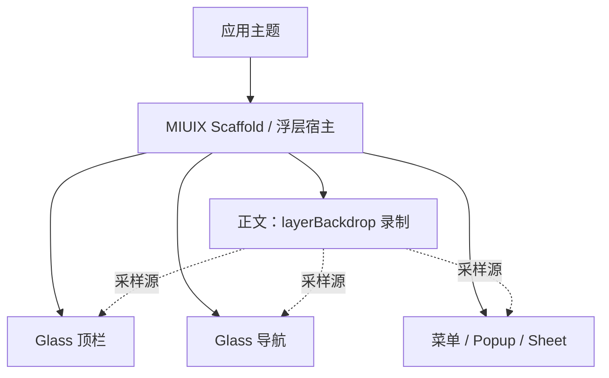

# MIUIX OS4 / Glass 跨项目迁移指南

列表视图的常驻分段切换、进一步筛选及参考项目研究，见
[OS4 列表视图切换与进一步筛选](miuix-os4-visible-views.md)。

2026-11-18 增量迁移将应用依赖更新为 `0.9.4-76504ab0-SNAPSHOT`。
浮动操作和工具栏应优先使用新的原生容器，导航角标应使用原生插槽；
发布完整性核对与迁移记录见 [MIUIX Snapshot 迁移](miuix-snapshot-76504ab0.md)。

这份文档总结 KeiHome 的实际迁移、源码核对和设备验收经验，供其他
Compose Android 项目规划和实施 OS4 UI 使用。重点是材质、采样、交互和状态
如何共同工作，以及哪些地方可以复用封装。

**核对日期：2026-11-15。源码基线：MIUIX
`d8efe1872c08c863a8b33e7044dd2a8b43038032`，依赖
`0.9.4-d8efe187-SNAPSHOT`。** 示例使用这一版的 API。后续迁移应重新检查目标
版本源码；本指南不表示每个 Snapshot 都兼容，也不表示其他项目已通过设备验收。

文中的 `Glass*`、`BackdropPipeline` 是上游 API；`KeiHome*`、`Os4*` 是本项目
封装，其他项目需要自行引入或改写。相对链接指向可检查的实现，便于按职责移植。

## 1. 推荐推进顺序

1. 记录现有主题、导航、返回栈、用户偏好和代表性截图，保留原有交互语义。
2. 确定一个已经发布、可以解析的 MIUIX Snapshot，统一整组模块版本。
3. 建立应用主题和页面采样层，再迁移 Scaffold、顶栏及底部导航。
4. 迁移下拉选择、菜单、确认弹窗和 Sheet，核对其实际浮层宿主。
5. 调整搜索、分段切换、帮助和状态详情的交互，减少页面内的长说明。
6. 处理关闭模糊、大字体、长标签、键盘、系统返回和操作衔接。
7. 跑受影响的定向用例，再验收最终签名、压缩后的 Release。

建议先在一个有长列表、工具栏操作和帮助入口的真实页面打通全链路，再抽出共享
封装。只有展示效果的 Demo 无法覆盖页面退出、数据加载和文件选择器交接。

## 2. 版本、模块与源码核对

`0.9.5-670cf597-SNAPSHOT` 对应上游
[670cf597](https://github.com/compose-miuix-ui/miuix/commit/670cf5975c157b64d625d94deca7e7c21bd4a7b6)。
增量迁移见 [Snapshot 审查](miuix-snapshot-670cf597.md)。Glass 输入用于 Monet
色值、缓存预算、连接设置和日志自定义时长。搜索保留共用的搜索控件及展开、取消、返回
语义。需要文字和进度的主操作沿用 `GlassFloatingToolbar`，由共用封装
提供无障碍状态，并使用新版主操作材质。

原生底栏使用 MIUIX 自己的系统栏和小窗标题栏 inset。自定义 Liquid
底栏合并两种 inset，统一预留一次。宽屏侧栏使用上游的分组动画。
收起时由应用提供当前父标签，直接从其他分组进入也能选中正确标签。

使用一个版本别名管理项目实际用到的 `ui`、`icons`、`preference`、`nav`、
`blur`、`squircle`、`glass`、`glass-icons`、`material` 等模块，包括其传递依赖。
平台构件按项目的 Android / Multiplatform 结构选择，不必照搬 KeiHome 的全部依赖。

Snapshot 版本中包含提交哈希。仓库元数据的 `latest` 可能按字符串顺序排列，
不能据此判断提交新旧。需要分别确认：

| 核对项 | 具体做法 |
| --- | --- |
| 源码身份 | 确认完整提交 SHA，并读提交正文与实际 diff |
| 可用构件 | 用真实项目解析目标 Snapshot，检查有没有 `FAILED` 和模块混版 |
| API 与契约 | 同看组件源码、文档、示例以及近期修复，特别是宿主和动画规则 |
| 运行身份 | 保留最终源码 SHA、完整版本、签名、APK 哈希和安装回执 |

`gradle dependencies` 输出包含解析失败时，任务本身仍可能成功结束；检查输出后
还应编译真实应用。临时网络失败与符号不兼容要分开处理。

此前 `RuntimeShader`、`asBrush`、材质和边缘描边相关能力已经迁入
`top.yukonga.miuix.kmp.material`。迁移时按目标版本的真实包名修改，
不要用空实现或旧模块兼容层掩盖依赖混用。

最新一轮图标改动包含 `Settings → SettingsOutline`、`Folder → FolderOutline`、
`WorldClock → Time` 等重命名。新增图标可优先用于语义明确的入口，例如
`UsageHelp`、`AppData`、`Log`、`Item`。保留按钮原有动作、尺寸、颜色角色和
无障碍名称；图标名称相近不代表业务动作相同。

## 3. 先确定主题、宿主与采样的所有权

### 3.1 一套应用主题作为来源

系统外观、应用保存的深浅设置、Monet 或固定配色，应共同进入应用现有的主题控制器。
Glass 的深浅判断使用这个最终结果。用户在亮色系统中选择应用深色时，直接读取
`isSystemInDarkTheme()` 会让面板、按钮和页面错配。

带 shading 的控制显式传入 `GlassDefaults.style(dark)`。普通对话框与 Sheet
按其 API 使用 `GlassMaterials.dialogGlass(dark)` 和对应的主题描边。
`GlassDefaults.Style` 不是应用主题的自动选择器。

材质不只是模糊，还包含按顺序混合的颜色层。仅加 blur 容易在深色页面形成透明洞。
同一表面重复叠加完整 material 和 glass shading，则可能发灰、发脏。
优先使用组件自带材质；只有明确知道缺少哪一层时才补充自定义绘制。

参考：[主题](../app/src/main/kotlin/os/kei/hyper/home/ui/theme/Theme.kt)、
[Glass 弹窗封装](../app/src/main/kotlin/os/kei/hyper/home/ui/components/Os4Dialogs.kt)。

### 3.2 Scaffold 同时提供浮层宿主

MIUIX 的 `Scaffold` 会提供并渲染原生浮层使用的状态列表。
`renderInRootScaffold = true` 使用外层宿主；`false` 使用当前宿主。
**这两个值都不表示创建独立 Android Window。**

一个只用 `Box` / `SubcomposeLayout` 搭建的自定义页面，可能没有实际渲染这些列表。
此时 `show` 已变为 true、点击也有响应，Sheet 仍可能完全不出现。

KeiHome 使用向导的处理是：在保留自定义全屏布局、浮动页脚和渐隐的前提下，
外包一层 MIUIX Scaffold 提供宿主。零 `contentWindowInsets` 仅因为其内部已经自行
处理全屏边界；普通页面不应照抄这项设置。

参考：[向导布局](../app/src/main/kotlin/os/kei/hyper/home/ui/main/OnboardingPageLayout.kt)、
[Scaffold 封装](../app/src/main/kotlin/os/kei/hyper/home/ui/components/Os4Chrome.kt)。

### 3.3 录制页面内容，Glass 在外部采样



录制层与消费者的职责：

- `rememberLayerBackdrop()` 创建、记住页面录制对象。
- `Modifier.layerBackdrop(backdrop)` 标记实际正文。
- 顶栏、导航、浮层及其遮罩和阴影放在该录制层外，消费这个对象。
- 浮层穿过根宿主后，继续使用打开它的页面的采样源与主题上下文。

不能把包含 Glass 自身的整个 Scaffold 录制回它所采样的源。
页面里的分段控制尤其容易形成这种自引用。KeiHome 的内联分段控制使用绘制
主题 surface 的叶子 `Backdrop`，而非重新采样包含它自己的页面。

参考：[页面录制](../app/src/main/kotlin/os/kei/hyper/home/ui/main/MainScreen.kt)、
[分段控制](../app/src/main/kotlin/os/kei/hyper/home/ui/components/Os4ViewTabs.kt)。

## 4. 最小列表页面骨架

下面是用于说明结构的示例。调用方已提供 `MiuixTheme`；
`dark` 来自应用的最终外观，`blurEnabled` 已结合用户设置及平台能力。
它演示渐进顶栏路径，不包含 Gaussian 自定义条带、导航或业务浮层。

```kotlin
import androidx.compose.foundation.layout.fillMaxSize
import androidx.compose.foundation.layout.padding
import androidx.compose.foundation.lazy.LazyColumn
import androidx.compose.runtime.Composable
import androidx.compose.runtime.remember
import androidx.compose.ui.Modifier
import androidx.compose.ui.input.nestedscroll.nestedScroll
import androidx.compose.ui.unit.dp
import top.yukonga.miuix.kmp.basic.MiuixScrollBehavior
import top.yukonga.miuix.kmp.basic.Scaffold
import top.yukonga.miuix.kmp.basic.ScrollBehavior
import top.yukonga.miuix.kmp.basic.Text
import top.yukonga.miuix.kmp.basic.rememberTopAppBarState
import top.yukonga.miuix.kmp.blur.layerBackdrop
import top.yukonga.miuix.kmp.blur.rememberLayerBackdrop
import top.yukonga.miuix.kmp.glass.GlassTopAppBar
import top.yukonga.miuix.kmp.material.GlassDefaults
import top.yukonga.miuix.kmp.utils.overScrollVertical

@Composable
private fun Modifier.os4Scroll(behavior: ScrollBehavior): Modifier {
    val state = behavior.state
    val update: (Float) -> Unit = remember(state) {
        { state.overscrollOffset = it }
    }
    return overScrollVertical(onOffsetChanged = update)
        .nestedScroll(behavior.nestedScrollConnection)
}

@Composable
fun GlassListExample(dark: Boolean, blurEnabled: Boolean) {
    val backdrop = if (blurEnabled) rememberLayerBackdrop() else null
    val behavior = MiuixScrollBehavior(rememberTopAppBarState())
    Scaffold(
        topBar = {
            GlassTopAppBar(
                title = "Example",
                backdrop = backdrop,
                style = GlassDefaults.style(dark),
                progressiveBlur = blurEnabled,
                scrollBehavior = behavior,
            )
        },
    ) { insets ->
        LazyColumn(
            modifier = Modifier.fillMaxSize()
                .then(
                    if (backdrop != null) Modifier.layerBackdrop(backdrop)
                    else Modifier,
                )
                .os4Scroll(behavior),
            contentPadding = insets,
            overscrollEffect = null,
        ) {
            items(40) { index ->
                Text("Item $index", modifier = Modifier.padding(16.dp))
            }
        }
    }
}
```

实际页面再增加自己的数据加载、国际化和列表 key。纯长表单与长应用列表可以选择
不同的滚动容器，不必为了统一外观强制使用同一种列表。

## 5. 顶栏、回弹、导航和安全区域

### 滚动与弹性位移分开

真实滚动进入 `contentOffset`，弹性拉伸进入 `overscrollOffset`。
不能把回弹位移累加到真实内容偏移，否则短页面下拉后顶栏可能留在错误状态。
上面 `overScrollVertical(...).nestedScroll(...)` 的顺序是已验证组合。

容器已经使用这套回弹时，关闭其自带 `overscrollEffect`，避免两套系统同时位移。
顶栏的实际状态还要连接当前正在显示的列表；分页页面不能始终读取第一个 Tab 的状态。

### 内容从材质后经过

将 Scaffold 给出的 padding 放进滚动内容的 `contentPadding` 或滚动容器内部。
给整个列表外侧先加 top padding，会使内容永远不能经过顶栏背后。
同时保留底部导航、手势条、挖孔及悬浮按钮需要的安全空间，避免重复叠加 inset。

### 顶栏使用已有默认值

`d8efe187` 修正了折叠标题和副标题组合的对齐。该版默认背景 overhang 为 28dp，
底边渐隐覆盖内部 12dp 加 overhang，按实测背景高度计算。
这些是版本契约，不应成为每个项目重新硬编码的常量。

Gaussian 路径和渐进路径应明确选择，避免自定义模糊条带上再叠一套渐进处理。
KeiHome 的 Gaussian 路径使用透明 band brush，让已有均匀模糊负责背景。

独立上游 `SmallTopAppBar` 在本基线中测量 action slot 后缺少放置。
KeiHome 当前入口不使用该路径，已经实测长标题下的双操作按钮。
其他项目若使用它，需要单独验证，并在升级修复版本后重新评估。

### 导航保持一个状态来源

导航组件请求切页，Pager / 导航控制器拥有实际页面状态。
拖动预览、取消和落地选择要由同一协调器处理，避免高亮与页面脱节。
图标、更新角标应只有一个有效的无障碍节点，光学录制副本不应重复播报。

多风格项目可以保留既有 iOS-like 导航，但应让两套实现独立选择、独立绘制。
KeiHome 的 `IOS_LIKE` / `OS4_GLASS` 是其保存值，不是 MIUIX 的全局标准。

## 6. 组件选择与页面信息层级

| 信息或操作 | 推荐形式 | 核对重点 |
| --- | --- | --- |
| 顶栏或悬浮图标操作 | `GlassIconButton` | 采样来源、点击区域、禁用和内容颜色 |
| 短、只读、与按钮相关的说明 | `GlassTransformPopup` | 锚点、焦点、退出动画 |
| 较长帮助、状态诊断、编辑器、导入流程 | Sheet | 高度、滚动、返回及后续操作 |
| 明确的确认、删除或风险提示 | `GlassDialog` + 原生按钮 | 动作角色、禁用、大字体 |
| 同一内容的少量互斥视图 | `GlassSegmentedTabRow` | 完整标签、溢出可横向滚动 |
| 内容分类切换 | `GlassTabRow` | 分类含义、选中项可见性 |
| 简单设置选择 | `GlassDropdownPreference` 等封装 | 禁用与空列表、当前选择 |
| 分组、排序、多层菜单 | Glass 图标菜单 | 原有分组、勾选与收起规则 |
| 页面主要生成／导入操作 | 悬浮操作按钮 | 底部安全距离、忙碌禁用 |

分段控制的高度应跟随所用文本样式和 font scale。测量选中、未选中两种字体，
为完整标签预留宽度；宽度不足时让轨道在页面内横向滚动，并显示当前选项。

内容卡片、表单、开关和滑块可以继续使用普通 MIUIX 控件。Glass 主要承担顶部、
导航和浮层等层次；自定义 `GlassPanel` 应有明确的采样与布局需求，避免把每个
列表项都变成独立的重采样面板。

### 帮助默认简洁，重要状态留在页面

短说明改为按钮旁浮层，长说明放入 Sheet。必要时按“页面 + 提示修订号”记录首次
展示，首次进入弹一次，之后保留手动帮助入口。不要用完整 build number 当作修订号，
否则每个内部构建都重复提示。

下载进度、失败原因、未保存或待重新生成等重要状态应继续可见。
长说明的折叠不应让用户失去当前操作是否可执行的依据。

### 状态摘要与诊断详情

运行状态和 Monet 等动态信息适合保留紧凑摘要卡，点击打开诊断 Sheet。
面板顶部可重复摘要与时间，再分组列出细节，便于截图携带状态上下文。

使用可换行的状态 pill / `FlowRow`，避免长值挤压标签。标识符和 Diagnostic 允许
换行或复制；区分“关闭”“未提供”“等待”“读取失败”，颜色配合文字表达。

冷启动尚未读取时显示中性的检查状态，不能把初始空值当作红色失败。
缓存可用于过渡，但必须重新校验并及时更新；已确认失败时不能继续展示旧的绿色就绪。

参考：[状态面板](../app/src/main/kotlin/os/kei/hyper/home/ui/main/StatusContent.kt)、
[首次帮助](../app/src/main/kotlin/os/kei/hyper/home/ui/main/PackGuidance.kt)。

## 7. 浮层生命周期与后续操作

### 展示状态不等于挂载状态

建议分别管理：

| 状态 | 含义 |
| --- | --- |
| `show` / `expanded` | 请求打开还是请求关闭 |
| `mounted` | 宿主和内容是否仍留在 composition 中 |
| `pendingAction` | 退出完成后要执行的导航、文件选择等操作 |

关闭时先令 `show = false`。等原生退出完成，再移除宿主并执行待办动作。
直接写 `if (show) GlassBottomSheet(...)` 会让外层先消失，退出动画无法结束。
KeiHome 的 `Os4DetailsSheet` 是自己的封装，并非可从 MIUIX 直接导入的类。

存在 `onDismissFinished` 时优先使用该回调。菜单等没有相应回调的入口，需要按其
实际动画所有权保留宿主；当前图标菜单封装等待原生 `GlassMotion.transformCenter`
对应的退出，而不是固定延迟几百毫秒。不要把某一组件的回收机制套给所有浮层。

### 先关闭，再交接

文件选择、导航、导出、授权等动作，从关闭完成回调交接。关闭期间禁止重复点击；
动作交付后清空待办状态。普通 Back、外部点击和下滑关闭不应被当成确认。
交接中保存用户当时选定的范围、来源或目标，避免读取后来变化的表单状态。

当前实现参考：

- [Sheet](../app/src/main/kotlin/os/kei/hyper/home/ui/components/Os4DetailsSheet.kt)
- [确认布局](../app/src/main/kotlin/os/kei/hyper/home/ui/components/Os4ActionDialog.kt)
- [浮层菜单](../app/src/main/kotlin/os/kei/hyper/home/ui/components/Os4DropdownMenu.kt)
- [短说明与焦点恢复](../app/src/main/kotlin/os/kei/hyper/home/ui/components/Os4InfoPopup.kt)

App 日志导出的五秒等待是业务规则，由单调时钟的截止时间与回调二次检查保证，
不是按钮上的数字动画。重新打开或重建后重新等待，取消不导出，只交付一次。
这类规则应由业务层保留，迁移组件外观时不能丢掉。

### 锚点、坐标、上下文与焦点

使用 `rememberGlassPopupAnchor`、`glassPopupAnchor` 和 `glassPopupAnchorContent`
登记触发器。等待锚点有有效测量后打开；原生菜单已负责窗口坐标到宿主坐标的转换，
不要再手动减一次宿主原点。

穿过根 portal 时需要保留页面的主题和采样上下文；本项目按需传递
`currentCompositionLocalContext`，业务事件仍由原页面持有。

打开后把焦点移入内容，退出后再恢复触发器。覆盖 Back、Escape、外部点击与
无障碍 dismiss。触摸模式下，恢复焦点有时还需要显式 `focusProperties`。

在已经集成返回分发的 Activity 上，先检查现有 NavigationEvent 层级，
不要给每个 Popup 再叠一套平台 Back 输入。组件返回测试和真实系统返回验收应分开。

## 8. 阴影、间距、按钮和大字体

OS4 视觉上的常见问题来自双重装饰与多次 inset，而非需要更复杂的 shader。

- 确认宿主是否已经提供内容边距。当前对话框链路已有 24dp，
  再加同样边距会导致窄内容区、对齐偏移。
- Sheet 内优先使用平面的分组内容、间距和分隔线。嵌套带厚阴影的 Card
  容易把整个面板切成悬浮的小块。
- 阴影需要绘制空间，检查父级裁剪；窗口边缘、圆角、背景与阴影应分别核对。
- 主操作使用 `Primary`、删除等使用 `Destructive`，取消使用 `Normal`。
  按钮内文字使用组件提供的 `LocalContentColor`。
- 长标签、窄宽度或大字体时改为纵向动作组。KeiHome 的 320dp / font scale 1.3
  分界是自己的布局策略，移植后应按真实内容重新测试。
- Sheet 内容需要有界滚动；大型列表应自行提供合适容器，避免在无限高度里嵌套滚动。

原生 Glass 控件保留自己的按压反馈。自定义点击／切换表面使用 `glassPress`
时，应与 `clickable` / `toggleable` 共享同一个 `MutableInteractionSource`，
使按下、取消和释放来自同一事件流。可点击区域只保留一个业务回调与无障碍动作。
叠加第二套缩放动画或另建按压源容易出现反馈不同步。
参考：[自定义表面按压封装](../app/src/main/kotlin/os/kei/hyper/home/ui/components/Os4Press.kt)。

关闭 blur 或不支持对应渲染能力时，传递空采样源并使用组件的不透明降级。
控制仍应保留选中、禁用、返回、焦点和点击语义。不能只把面板透明度降到零，
也不能每个屏幕暗中开启一套背景采样。

参考：[动作布局说明](os4-action-dialogs.md)。

## 9. 搜索、数据与绘制性能

### 搜索编辑与筛选结果分别保存

进入编辑显示取消，退出编辑收起键盘；关键词、筛选、排序和返回位置仍由页面拥有。
清空文本应是显式动作。KeiHome 采用自己的 Compose 编辑封装，是因为该版本上游
`InputField` 的展开状态切换会重置文本，与保留筛选的交互冲突。

这是业务契约驱动的特例，不要求其他项目放弃上游输入框。已有需求不同或目标版本
已修复时，应重新选择。非搜索表单不应跟着进入搜索展开模式。

参考：[搜索封装](../app/src/main/kotlin/os/kei/hyper/home/ui/main/Os4SearchField.kt)。

### `BackdropPipeline` 用稳定参数描述效果

KeiHome 的 Gaussian 条带使用实现 `BackdropPipeline` 的不可变值对象，
包含实际颜色与半径，`configureEffects` 中配置 `textureBlurEffect`。
用这些实际参数作为 `remember` 的 key。

相等参数可以保留 modifier 的渲染状态；主题颜色、半径和密度换算结果改变时，
必须正常更新。只有字段确实不可变时才标 `@Immutable`，不能借此隐藏可变数据。
半径单位按目标 API 核对，不能混用 dp 与绘制坐标。

参考：[值对象](../app/src/main/kotlin/os/kei/hyper/home/ui/components/KeiHomeBackdropPipeline.kt)、
[实际条带](../app/src/main/kotlin/os/kei/hyper/home/ui/components/MiuixSampleChrome.kt)。

源码层面的复用不等于已经测得 FPS 或内存提升。先通过主题、半径、密度变化下的
图像一致性，再对 Release 做实际性能测量。

### 信息读取不随每次进页重做

大应用列表、包元数据和图标需要后台读取、分批交付及有边界的缓存失效。
页面先展示已经可用的内容；避免首屏同步全量哈希、解码和遍历。
绘制改成 Glass 后仍要单独检查这些数据路径，不能把等待都归因于模糊。

高频滚动、按压和传感器值尽量在布局或绘制阶段读取，降低整棵页面的重组。
但不能为了减少重组冻结时间、进度、诊断和授权状态。

## 10. 常见现象速查

| 现象 | 优先检查 |
| --- | --- |
| `show = true`，Sheet 不出现 | 调用处是否位于实际渲染浮层列表的 MIUIX Scaffold 内 |
| 深色面板像透明洞，或异常发灰 | 材质混合层是否缺失，或完整材质与 shading 是否重复 |
| 分段控制闪烁、录制异常 | 是否采样了包含自身的父录制层 |
| 顶栏回弹后不恢复 | 弹性位移是否进入真实 content offset，是否有双重 overscroll |
| 顶栏始终没有内容经过 | top padding 是否在滚动容器外，状态是否接错列表 |
| 菜单位置整体偏移 | 是否重复转换窗口／宿主坐标，锚点是否完成测量 |
| 关闭没有动画、阴影突然消失 | 宿主是否提前离开 composition，是否被父层裁剪 |
| 文件选择器闪退回原页或重复打开 | 是否在浮层退出前交接，是否重复消费待办动作 |
| 更新主题后 Glass 颜色仍旧 | 是否保存了旧 locals、style 或漏了 pipeline 的 key |
| 关闭模糊后按钮不可用 | 是否误把 backdrop 为空当成禁用控制的条件 |
| 大字体标签截断、动作挤出 | 是否固定轨道高度／宽度，是否缺少纵向动作布局 |
| 冷启动闪红再变绿 | 初始“未读取”是否误用了失败状态 |
| 新构建反复弹帮助 | 首次提示是否绑定到了每次变化的 build number |
| App 信息页进入仍很慢 | 是否在进页时全量查询、校验和解码，是否缺少缓存复用 |

## 11. 可复用封装与职责边界

| 层次 | 本项目参考 | 移植时保留的职责 |
| --- | --- | --- |
| Scaffold、顶栏、图标按钮 | [Os4Chrome](../app/src/main/kotlin/os/kei/hyper/home/ui/components/Os4Chrome.kt) | 宿主、采样源、主题、禁用语义、回弹连接 |
| 下拉选择 | [Os4DropdownPreference](../app/src/main/kotlin/os/kei/hyper/home/ui/components/Os4DropdownPreference.kt) | 有效选项、保存值、禁用规则 |
| 分组菜单 | [Os4DropdownMenu](../app/src/main/kotlin/os/kei/hyper/home/ui/components/Os4DropdownMenu.kt) | 原生锚点、宿主退出、分组选中语义 |
| 短说明 | [Os4InfoPopup](../app/src/main/kotlin/os/kei/hyper/home/ui/components/Os4InfoPopup.kt) | 触发器、焦点、返回、无障碍和退出 |
| 长详情 | [Os4DetailsSheet](../app/src/main/kotlin/os/kei/hyper/home/ui/components/Os4DetailsSheet.kt) | 材质、边界、滚动、关闭完成 |
| 操作确认 | [Os4ActionDialog](../app/src/main/kotlin/os/kei/hyper/home/ui/components/Os4ActionDialog.kt) | 动作角色与自适应布局 |
| 分段／分类 | [Os4ViewTabs](../app/src/main/kotlin/os/kei/hyper/home/ui/components/Os4ViewTabs.kt) | 文字测量、轨道边界、叶子采样 |
| Gaussian 效果描述 | [KeiHomeBackdropPipeline](../app/src/main/kotlin/os/kei/hyper/home/ui/components/KeiHomeBackdropPipeline.kt) | 值相等、主题与参数变化 |
| 自定义表面反馈 | [Os4Press](../app/src/main/kotlin/os/kei/hyper/home/ui/components/Os4Press.kt) | 共享按压事件、取消、单一点击语义 |

封装负责统一外观和交互基础设施。用户选择、草稿、业务校验、任务状态和导航
仍由原页面或 ViewModel 负责，避免每个封装再创建第二套状态。

复用时保留文件已有的来源与许可说明。参考应用的风格拆分可以作为设计参考，
不应把它的全局主题分支、后台服务或 OEM 专用逻辑一起复制到另一个项目。

## 12. 验收范围与交付记录

| 维度 | 至少覆盖 |
| --- | --- |
| 外观 | 深／浅、固定色／Monet、Gaussian／渐进／关闭 |
| 文字与空间 | font scale 1.0 / 1.6、320dp 窄宽、长中文／英文／日文标签、RTL |
| 交互 | 打开、关闭、中断、重开、Back、Escape、外部点击、禁用与忙碌 |
| 系统边界 | 键盘、手势区、挖孔、文件选择、授权和导航交接 |
| 绘制 | 原位、滚动中、回弹中、退出中和最终落地；阴影、裁剪、背景均需可见 |
| 业务状态 | 首次加载、缓存过渡、成功、关闭、过期、真实失败与恢复 |
| 发布 | 最终 minified Release、签名、源码／APK／设备身份一致 |

组件测试可用真实 MIUIX 返回处理器配合受控输入测试，不要用测试回调假装返回成功。
对嵌套且裁剪的宿主，验证浮层能正确逃逸；外部点击应落在宿主实际接收事件的区域。
逐项检查重开后的语义唯一性与焦点恢复，不靠“取第一个节点”掩盖录制副本。

Instrumentation 命令的退出码可能在测试失败时仍为零，必须检查
`OK (N tests)`，并排除 `FAILURES!!!` / runner crash。如果使用单调时钟做业务等待，
Compose 的测试动画时钟推进不会替代真实 elapsed realtime。

本仓库可按改动范围选择以下组；它们不能代替其他项目自己的测试：

```bash
python3 scripts/checks.py ui-miuix-migration --serial DEVICE_SERIAL --run
python3 scripts/checks.py ui-os4-controls --serial DEVICE_SERIAL --run
python3 scripts/checks.py ui-os4-context --serial DEVICE_SERIAL --run
python3 scripts/checks.py ui-status-sheets --serial DEVICE_SERIAL --run
python3 scripts/checks.py ui-log-export --serial DEVICE_SERIAL --run
```

设备操作指定 serial，覆盖安装并保留数据。自动验收默认检查已有设备健康；
设备离线或健康失败应停止并报告，避免把启动、重启或 KeepAlive 混入验收。
当前本机只允许使用 HyperOS Phone AVD，不启动 ColorOS AVD。
其他项目按其用户授权选择设备，不把这个本机限制写成库的通用要求。

尤其不要用带自动重试语义的常驻任务承载一次性验收启动。此次曾定位到遗留的
launchd `KeepAlive` 任务反复拉起 ColorOS，已禁用卸载；手动启动入口独立保留。

验收记录应分别说明：构建通过、组件测试、真实界面观察、设备覆盖范围、安装身份、
进程交接、标签和远端发布。脚本成功、PID 不变或一个截图都不能替代全部结论。

## 13. 大快照、刷新与阴影

目录或映射列表更新为内容相等的新实例后，`remember(largeList)` 可能在后续
每次重组中反复深比较新旧列表。Pager 中保留的相邻页面也会参与，不能只看当前
页面是否做了 I/O。使用不可变快照的实例身份作为计算键，发布新内容时换实例；
筛选参数继续按值比较。不要把整个描述符或数万条映射直接当作高频重组的键。

拥挤工具栏可以把列表读取迁移到原生 `PullToRefresh`。`isRefreshing` 是业务状态，
需要在回调里及时抬起，完成和失败都收回；检查与现有 overscroll、折叠顶栏的
嵌套滚动连接，避免重复处理下拉。下拉刷新不应扩大原按钮的业务范围。
MIUIX `overScrollVertical` 可直接驱动继承的 PullToRefresh 状态；仅在外层阻止
nested scroll 不足以禁用下拉。后台加载时还需关闭内层 spring 的 `isEnabled`，
保留列表正常滚动和顶栏滚动连接，避免出现“松开刷新”却不执行的提示。
不提供下拉刷新的 Apple 首页与搜索页不挂载 PullToRefresh，保留原有弹性滚动。

应用更新后的性能需要保留进程复现。仅重启后验收会掩盖键比较或缓存生命周期问题。
具体调用栈、修复策略与验收条件见
[应用更新后的列表性能](apps-package-update-performance.md)。

原生 TabRow 的 Float 阴影会超出轨道边界。宽度适配与横向滚动容器必须把这部分
空间计入测量，而不是等阴影被父布局裁掉后再叠加模糊或渐变。当前 MIUIX 源码中
阴影最远距离为 `24 / SourceDensity(3) = 8dp`，包装层从原生参数推导四边 halo，
并留一个物理像素的抗锯齿余量。先从可用宽度扣除左右 halo，再判断是否需要横向滚动；
滚动到首尾时也要露出端部阴影。升级 MIUIX 后重新检查原生参数。

自定义说明按钮需要跟随工具栏上下文的绘制尺寸。当前 Glass 工具栏是 40dp，
独立入口保留 48dp；popover 的锚点圆角也使用对应半径。不能仅缩小内部图标，
仍让外层背景和锚点沿用 48dp。

设备测试的玻璃夹具也必须遵守采样边界：背景录制层与读取它的 GlassTopAppBar
使用兄弟节点。把顶栏放进 `.layerBackdrop(source)` 的子树会形成 RenderNode
自引用，可能直接在 `libhwui` 中递归崩溃，而不是抛出可捕获的 Compose 异常。
不要通过关闭硬件加速掩盖这个错误；真实页面与测试都使用正确的层级。

## 14. 版本记录与依据

- [早期 OS4 架构迁移](miuix-os4-migration.md)：材质、导航与统一封装。
- [19b5b831 迁移](miuix-19b5b831-migration.md)：搜索、短说明、分段控制和 Pipeline。
- [d8efe187 迁移](miuix-d8efe187-migration.md)：新图标、折叠标题、渐隐和已知上游问题。
- [向导布局](onboarding.md)：独立全屏布局与 Scaffold 浮层宿主的组合。
- [动作与语义](ui-actions-os4.md)、[确认弹窗](os4-action-dialogs.md)、
  [搜索与上下文帮助](os4-search-and-context.md)。

本轮本地证据位于 `.artifacts/research/miuix-d8efe187-20261115/`：
19 项定向 UI 用例、26 项 JVM 测试、最终 Release/R8、Lint，以及安装身份与热重载
回执。新图标视觉检查覆盖 HyperOS Phone AVD；实体机本轮覆盖安装身份与 Java
交接，不应扩展为所有图标、所有设备或其他项目的视觉验收。

上游依据固定到本次提交，避免未来文档漂移：

- [Glass 组件文档](https://github.com/compose-miuix-ui/miuix/tree/d8efe187/docs/components/glass)
- [Glass 顶栏](https://github.com/compose-miuix-ui/miuix/blob/d8efe187/docs/zh_CN/components/glass/glasstopappbar.md)
- [图标指南](https://github.com/compose-miuix-ui/miuix/blob/d8efe187/docs/zh_CN/guide/icons.md)
- [MIUIX Scaffold](https://github.com/compose-miuix-ui/miuix/blob/d8efe187/miuix-ui/src/commonMain/kotlin/top/yukonga/miuix/kmp/basic/Scaffold.kt)
- [Popup 宿主](https://github.com/compose-miuix-ui/miuix/blob/d8efe187/miuix-ui/src/commonMain/kotlin/top/yukonga/miuix/kmp/utils/MiuixPopupUtils.kt)
- [标题布局修正](https://github.com/compose-miuix-ui/miuix/commit/d8efe1872c08c863a8b33e7044dd2a8b43038032)
